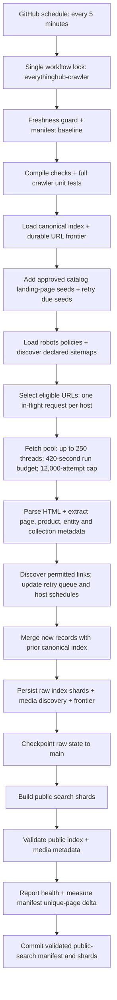
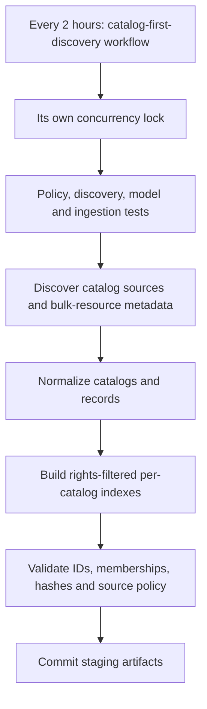

# Everything Hub crawler pipeline map

Verified against `.github/workflows/crawl.yml`, `crawler/crawl.py`, `crawler/index_store.py`, and `.github/workflows/catalog-first-discovery.yml` on 2026-11-24.

## Current production web-crawl path

## Separate catalog discovery path

Important: the catalog workflow's current validation explicitly requires `production_indexed=false`, `indexed_records=0`, and `records_published=0`. It creates and validates staging catalog artifacts; that is not proof of production publication.

## What the current design already protects

- The web-crawl workflow has one global concurrency group and does not cancel an in-progress run. This protects the shared frontier/index from concurrent crawler writers.
- The crawler resumes a durable frontier, deduplicates indexed/seen URLs, and preserves host cooldowns.
- It preloads robots policies, uses declared same-host sitemaps, honors robots-derived delays, and keeps one request per host in flight.
- Fetching is parallel within one run (up to 250 threads), but the run is bounded to 420 seconds and 12,000 attempts.
- The canonical index is stored in deterministic compressed shards; its small manifest is atomically replaced after shard writes.
- Raw crawl state is checkpointed before public-search validation. The public manifest is updated only after validation succeeds.

## Safe scale-up sequence

1. **Do not add parallel writers to the current shared index/frontier.** More workflow jobs against the same files would race, duplicate work, or overwrite state.
2. **Measure the bottleneck first:** active fetch latency, peak in-flight requests, distinct eligible hosts, per-host wait time, HTML parse time, queue growth, checkpoint time, and validation/publish time.
3. **Separate fetch output from shared-state mutation:** workers should emit immutable, run-scoped result batches keyed by canonical URL. A single reducer should deduplicate and merge those batches into the canonical index/frontier.
4. **Partition only the fetch frontier:** assign stable host-hash partitions to workers so every host belongs to one worker per run. Keep robots rules and per-host pacing enforced within each partition.
5. **Keep one publisher:** merge validated worker batches, build immutable search shards, run integrity checks, then atomically advance the public manifest.
6. **Ramp gradually:** test a small number of partitions first; compare net-new unique pages per active minute, 429/5xx rates, error rates, and backlog before increasing.

## Current measured starting point

The latest recorded production run in the project metrics was 395 net-new manifest pages over 420.78 active seconds: **56.32 new unique pages/minute**. Fetch attempts and pages processed/upserted are separate metrics and must not be reported as unique additions.

## First engineering change recommended

Add a **run-scoped fetch-batch format and deterministic reducer**, with tests for duplicate URLs, conflicting page versions, retry/frontier reconciliation, and idempotent replay. Keep the current single-writer workflow in place until those tests pass. Only then introduce a small host-partition matrix. Do not increase the worker count as a substitute for this change.
